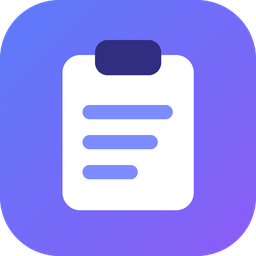

# ClipNest

A clipboard history manager for Windows 11. It runs in the system tray, saves the
text and images you copy, and opens a compact dark panel with **Ctrl+Shift+V** so
you can search, pin, preview and re-copy anything you copied before.

Everything stays on your PC. There are no accounts, no cloud sync, no analytics
and no network calls.



## Features

- **Clipboard history** for plain text and images, captured through Windows'
  clipboard change notifications (no polling). Consecutive repeats are ignored,
  older repeats move to the top instead of being saved twice, and items you copy
  back from ClipNest are never captured again as new entries.
- **Floating panel** with search, filter chips (All / Text / Images / Pinned),
  a pinned section, text previews, image thumbnails, timestamps, source app,
  and clear loading, empty and error states.
- **Pinned snippets** with optional titles. Pinned items are never removed by
  automatic cleanup but can be deleted on purpose.
- **Code preview** with syntax colors for 11 languages, a manual language picker
  and best-effort auto-detection. Text is only displayed, never run.
- **History limits**: maximum item count, storage size and age, plus
  "clear unpinned history" and "delete all data".
- **Privacy controls**: pause/resume (panel, tray and settings), excluded apps,
  and Windows' clipboard privacy markers are honored.
- **Optional auto-paste** into the window you were using (off by default).
- Dark, light or "same as Windows" theme, per-monitor DPI scaling, multi-monitor
  placement, full keyboard use, screen reader names, and reduced motion when
  Windows animation effects are turned off.

## Why this stack

ClipNest is a **C# / .NET 10 WPF** app. WPF is Microsoft's native Windows desktop
UI framework, so the app can call the documented Win32 clipboard, hotkey and
notification-area APIs directly, with no browser engine and no extra runtime
beyond .NET. History is stored with **SQLite** through Microsoft.Data.Sqlite.
The only third-party runtime dependency is SQLite itself.

## Requirements

- Windows 11 (recent Windows 10 versions should also work, but were not a target)
- To build: the **.NET 10 SDK** (10.0.100 or newer)
- To run a self-contained build: nothing extra

## Build, test and run (Windows 11)

Open **PowerShell** in the folder that contains `ClipNest.sln`.

```powershell
# 1. install the .NET 10 sdk (skip if `dotnet --list-sdks` already shows 10.0.x)
winget install Microsoft.DotNet.SDK.10

# 2. check it, then restore packages
dotnet --list-sdks
dotnet restore ClipNest.sln

# 3. build everything
dotnet build ClipNest.sln -c Release

# 4. run the tests
dotnet test ClipNest.sln -c Release

# 5. run the app
dotnet run --project src\ClipNest.App\ClipNest.App.csproj -c Release
```

After step 3 you can also start the app directly:

```powershell
.\src\ClipNest.App\bin\Release\net10.0-windows\ClipNest.exe
```

ClipNest starts in the notification area (the tray, near the clock). Press
**Ctrl+Shift+V** or click the tray icon to open the panel.

> If `dotnet restore` reports that a package version cannot be found, change the
> version in the `.csproj` to the newest 10.0.x / 2.9.x / 3.1.x / 18.0.x release
> shown on nuget.org.

You can also open `ClipNest.sln` in **Visual Studio 2026** (the version that
supports .NET 10), set `ClipNest.App` as the startup project and press F5.

## Using ClipNest

| Key | Action |
|---|---|
| Ctrl+Shift+V | Open or close the panel (changeable in Settings) |
| Type | Search text and pinned titles |
| Up / Down, Page Up / Page Down | Move through the list |
| Enter or double-click | Copy the selected item (and paste it, if auto-paste is on) |
| Esc | Close the panel and return to your previous window |
| Ctrl+P | Pin or unpin |
| F2 | Give a pinned item a title |
| Ctrl+E | Open the code preview |
| Delete (list focused) | Delete the item (pinned items ask first) |
| Ctrl+F | Jump to the search box |
| Tab | Move between search, filters, list and buttons |

Right-click an item for the same actions. Closing the panel or the Settings window
keeps ClipNest running; quit from the tray menu. Starting ClipNest a second time
just opens the panel of the copy that is already running.

## Packaging a distributable app

The script runs the tests and then publishes a **single self-contained
`ClipNest.exe`** (the .NET runtime is included, so users need nothing else) and
zips it:

```powershell
powershell -ExecutionPolicy Bypass -File scripts\package.ps1
# or for arm64 PCs:
powershell -ExecutionPolicy Bypass -File scripts\package.ps1 -Runtime win-arm64
```

Output: `publish\win-x64\ClipNest.exe` and `dist\ClipNest-win-x64.zip`.

The same publish step by hand:

```powershell
dotnet publish src\ClipNest.App\ClipNest.App.csproj -c Release -r win-x64 --self-contained true -p:PublishSingleFile=true -p:IncludeNativeLibrariesForSelfExtract=true -o publish\win-x64
```

For a much smaller download that needs the **.NET 10 Desktop Runtime** installed
on the target PC, use `--self-contained false` instead.

The exe is not code-signed, so Windows SmartScreen may warn on first launch
("More info" → "Run anyway"). Sign it with your own certificate (`signtool`) if
you distribute it widely.

## Project structure

```
ClipNest.sln
├─ src/ClipNest.Core/            plain .NET library, no Windows UI code, fully unit tested
│  ├─ Capture/                   capture rules, privacy markers, excluded apps, size limits, bitmap headers
│  ├─ History/                   HistoryService (capture, repeats, copy back, pin, delete, cleanup), self-copy guard
│  ├─ Storage/                   SQLite database, queries and search, image file store
│  ├─ Settings/                  settings model, safe json storage, shortcut parsing
│  ├─ Code/                      language detection and syntax coloring
│  ├─ Text/                      previews, relative times, sizes
│  └─ Diagnostics/AppLog.cs      error log that never receives clipboard content
├─ src/ClipNest.App/             the WPF app
│  ├─ Platform/                  Win32 interop: clipboard listener and access, hotkey, tray icon,
│  │                             auto-paste, single instance, startup entry, image encoding, placement
│  ├─ Services/                  AppController (wires everything), CaptureCoordinator, ThemeManager
│  ├─ ViewModels/                state for the panel, its rows and the settings window
│  ├─ Views/                     history panel, settings, code preview, small dialog
│  ├─ Themes/                    Dark.xaml, Light.xaml colors and Controls.xaml styles
│  └─ Assets/                    original icons
├─ tests/ClipNest.Core.Tests/    xUnit tests
├─ scripts/package.ps1           test + publish + zip
└─ tools/make_icons.py           draws the icons (needs Python and Pillow)
```

Clipboard handling (`Platform`), storage and search (`Core/Storage`), history
rules (`Core/History`) and UI (`Views`, `ViewModels`) are kept separate. All
database and file work runs on background threads.

## Your data: where it is and how to delete it

**Clipboard content you copy while capture is on is saved to disk, unencrypted,
on this PC** until you delete it or the limits remove it. It is stored in:

```
%LOCALAPPDATA%\ClipNest
```

| File | Contents |
|---|---|
| `history.db` (+ `history.db-wal`, `history.db-shm`) | Saved text, titles, timestamps, source app names |
| `images\` | Captured images and their thumbnails as PNG files |
| `settings.json` | Your settings |
| `logs\app.log` | Short error and status messages. Never clipboard content. |
| `*.damaged-*` | Backups made if a damaged settings or database file was replaced |

Ways to delete data:

- **One item**: select it and press Delete (or the trash button).
- **Unpinned history**: "Clear history" in the panel footer or in Settings.
- **Everything**: Settings → "Delete all clipboard data…" removes all items,
  pinned ones and every image.
- **By hand**: quit ClipNest from the tray, then:

  ```powershell
  Remove-Item "$env:LOCALAPPDATA\ClipNest" -Recurse -Force
  # only if you turned on "Start with Windows":
  reg delete "HKCU\Software\Microsoft\Windows\CurrentVersion\Run" /v ClipNest /f
  ```

Deleted rows are overwritten inside the database file (SQLite `secure_delete`),
and the file is compacted after large deletions.

## What gets captured

| Clipboard content | What happens |
|---|---|
| Plain text (and the plain-text part of rich text, HTML, Office copies) | Saved as plain text. Formatting is never stored, so every copy back is plain text. |
| Bitmap images and PNG images (screenshots, images copied from browsers or editors) | Saved as PNG with a thumbnail |
| Text and an image together (for example Excel cells) | The text is saved |
| Files copied in Explorer, audio, custom app formats | Not supported yet. The panel shows a short note. |
| Text over 1,000,000 characters | Skipped (not cut), so copies stay exact |
| Images over 12,000 px on a side or 40 megapixels | Skipped to protect memory and disk |
| Data marked private by the source app | Never saved (see below) |

Search covers text and pinned titles. **Image contents are not searchable**
(there is no OCR); images can be found by their pinned title. For very long
text, the first 32,768 characters are searchable.

## Privacy behavior and honest limitations

- ClipNest honors the documented Windows formats
  `ExcludeClipboardContentFromMonitorProcessing` and
  `CanIncludeInClipboardHistory` (value 0), plus the older
  `Clipboard Viewer Ignore` marker that several password managers use.
- **Excluded apps are best effort.** Windows does not reliably say which app put
  data on the clipboard. ClipNest checks the clipboard owner window and falls back
  to the foreground app; both can be wrong (background copies, helper processes).
- **ClipNest cannot reliably detect passwords or other sensitive text.** Pause
  capture (panel pill, tray menu or Settings) before copying secrets.
- Pausing is remembered across restarts, and the tray icon turns grey with a
  pause badge while paused.
- Logs contain only short messages and error types, never clipboard text.

## Platform notes

- **Auto-paste** (off by default) brings back the window you were using and
  sends Ctrl+V. Windows blocks simulated keys into apps running as administrator
  (User Interface Privilege Isolation), so ClipNest checks for that and tells you
  to press Ctrl+V yourself. It also only knows the previous window when the panel
  was opened with the shortcut, not from the tray. Copying always works even if
  pasting fails.
- **Ctrl+Shift+V** is "paste as plain text" in some apps (browsers, Office).
  While ClipNest owns that shortcut, those apps will not receive it. If the
  shortcut is already taken by another app, ClipNest shows a notification and you
  can pick another in Settings; the tray icon always works.
- If another app holds the clipboard open, ClipNest retries for about one second
  and then reports that the clipboard was busy.
- ClipNest runs separately from Windows' own clipboard history (Win+V).

## Verification status

What was checked when this project was produced, in a Linux build environment
(no Windows machine was available):

| Check | Result |
|---|---|
| `ClipNest.Core` build (.NET SDK 10.0.113) | Passed, 0 warnings |
| Core unit tests: 125 tests (duplicates, search and filters on both search paths, settings persistence and damaged files, retention and pinned preservation, image file cleanup, self-copy suppression, capture rules, bitmap headers, code coloring) | **125 passed, 0 failed** |
| Bitmap conversion cross-checked with an independent decoder (Pillow) | Passed |
| All `ClipNest.App` C# compiled against reference assemblies built from the official dotnet/wpf v10.0.13 sources | Passed, 0 errors, 0 warnings |
| All 8 XAML files checked by a custom validator (element types, properties, attached properties, events and handlers, enum values, resource keys, template bindings, setter targets, binding paths; about 1,500 attributes) | Passed (the validator was confirmed to catch planted typos) |
| Comment style audit (539 comments, all lowercase) | Passed |

Important caveats:

- **NuGet was blocked in that environment**, so the tests ran against
  Microsoft.Data.Sqlite compiled from its official v10.0.13 source with the
  system SQLite (3.45.1), using a minimal runner for `[Fact]`/`[Theory]` with the
  real xUnit assertion source. On Windows, `dotnet test` uses the real packages.
- **The WPF app was not built by the real WPF build tools and was not run.**
  Windows clipboard integration, the global hotkey, tray icon, auto-paste,
  DPI/multi-monitor placement, visuals and packaging have **not** been tested on
  Windows. Please run the build and test commands above first; if anything fails,
  the error output will point to the file and line.
- No prebuilt `.exe` is included, because Windows executables could not be built
  in that environment. `scripts\package.ps1` creates one on Windows.

## Dependencies and versions

| Package | Version | Used by |
|---|---|---|
| .NET SDK | 10.0.100+ (pinned by `global.json`, newer 10.0 SDKs allowed) | build |
| Microsoft.Data.Sqlite | 10.0.13 | ClipNest.Core |
| xunit | 2.9.3 | tests |
| xunit.runner.visualstudio | 3.1.5 | tests |
| Microsoft.NET.Test.Sdk | 18.0.1 | tests |

See `THIRD-PARTY-NOTICES.md` for licenses and attribution. ClipNest itself is MIT
licensed (`LICENSE`). The icons are original and were drawn by
`tools/make_icons.py`.

## Troubleshooting

- **Nothing happens when I press the shortcut**: another app may own it. Look
  for a ClipNest notification, or open Settings from the tray and choose another
  shortcut.
- **History panel shows "Could not load history"**: click "Try again". If the
  database was damaged, ClipNest moves it aside as `history.damaged-*.db` and
  starts fresh.
- **Settings were reset**: the settings file was damaged; the old file is kept as
  `settings.damaged-*.json` in the data folder.
- **Something else**: check `%LOCALAPPDATA%\ClipNest\logs\app.log`.
